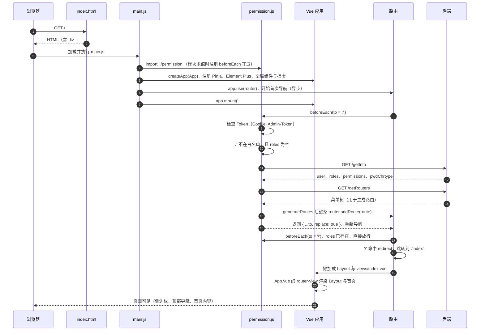
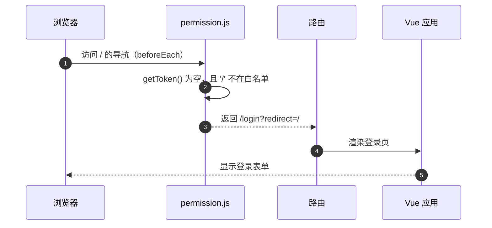

# 时序图：从浏览器请求 `/` 到页面可见

> 本图依据源码绘制：`index.html`、`src/main.js`、`src/permission.js`、`src/store/modules/user.js`、`src/store/modules/permission.js`、`src/router/index.js`、`src/App.vue`。
> 未在浏览器中逐步实测，时序以代码阅读为准；后端接口路径与 `VITE_APP_BASE_API` 前缀相关，开发环境下请求会经过 Vite 代理（第 4 课）。

## 时序图（已登录、首次访问）

## 分支：未登录（没有 Token）

## 分支：已登录后再次访问（roles 已存在）

路由守卫不再调用 `/getInfo` 与 `/getRouters`，直接放行，因此页面几乎立即可见。

## 关键步骤说明

| 步骤 | 位置 | 说明 |
| --- | --- | --- |
| 1–2 | `index.html` | 提供挂载点 `#app`，并通过 `type="module"` 引入 `/src/main.js` |
| 3–4 | `main.js` | `import './permission'` 使守卫在模块求值时注册，早于首次导航 |
| 5–7 | `main.js` | `app.use(router)` 触发首次导航；随后注册 Pinia、插件与全局组件，最后 `app.mount` |
| 8 | `permission.js` | `beforeEach` 中先判断 Token，没有 Token 则进入登录分支 |
| 9–10 | `user.js` 的 `getInfo` | 请求 `/getInfo`，写入 `roles`、`permissions`，并把 `pwdChrtype` 存入 sessionStorage |
| 11–12 | `permission.js` 的 `generateRoutes` | 请求 `/getRouters`，把后端菜单转换为路由 |
| 13 | `permission.js` | `router.addRoute` 注册动态路由（第 17 课） |
| 14 | `permission.js` | 返回 `{ ...to, replace: true }`，让导航用新路由表重新执行 |
| 15–16 | `router/index.js` | `'/'` 的 `redirect` 指向 `'/index'`，其组件通过 `import()` 懒加载 |
| 17 | `App.vue` | `<router-view />` 渲染匹配到的布局与页面 |

## 注意点

- `app.use(router)` 早于 `app.mount`，但导航是异步的：挂载后 `router-view` 可能先为空，等守卫完成后才显示内容。
- 守卫中 `getInfo` 或 `generateRoutes` 失败时，会执行 `logOut()` 并回到 `/`（代码中 `catch` 分支），即回到登录流程。
- 路由守卫中的 `/lock` 锁屏分支与 `isRelogin` 弹窗状态在上图中省略，以突出主线。
